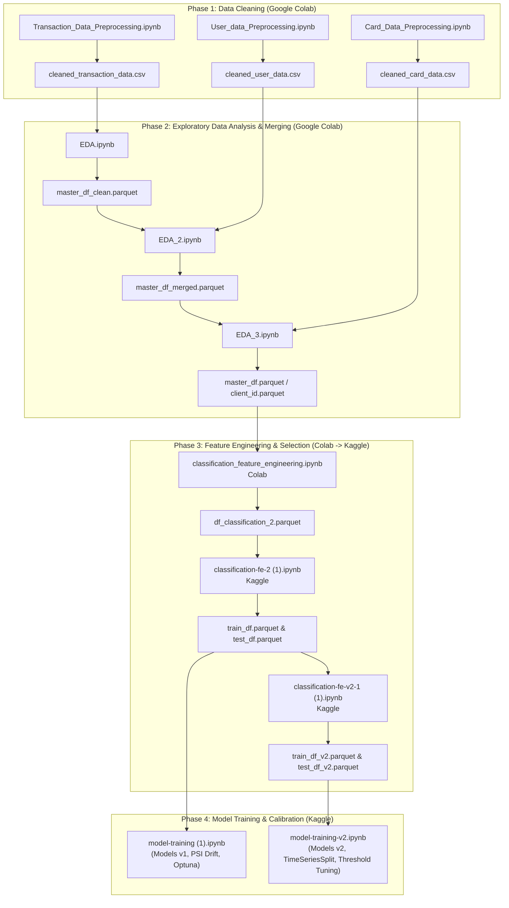

# FinGuard: Online Transaction Fraud Detection System

AI-powered Transaction Risk Intelligence Platform that integrates transaction, customer, card, and merchant data to detect fraud, identify anomalous transactions, and segment customers based on behavior. Features machine learning, clustering, anomaly detection, and interactive dashboards for risk analytics.

---

## Architecture


An end-to-end Machine Learning pipeline for large-scale financial fraud detection and classification. This repository contains the complete workflow—from ingesting and cleaning **13.3+ million transactions**, multi-table relational merging, exploratory analysis, leakage-free temporal feature engineering, multi-method feature selection, and data drift diagnostics, to advanced gradient boosted decision trees (**XGBoost**), Bayesian hyperparameter optimization, and **Precision-Recall decision threshold calibration**.

---

## Table of Contents
1. [Project Overview](#project-overview)
2. [Notebook Execution Sequence & Pipeline Architecture](#notebook-execution-sequence--pipeline-architecture)
3. [Chronological Notebook Breakdown](#chronological-notebook-breakdown)
   - [Phase 1: Data Cleaning & Preprocessing (Google Colab)](#phase-1-data-cleaning--preprocessing-google-colab)
   - [Phase 2: Exploratory Data Analysis & Unification (Google Colab)](#phase-2-exploratory-data-analysis--unification-google-colab)
   - [Phase 3: Leakage-Free Feature Engineering & Selection (Colab & Kaggle)](#phase-3-leakage-free-feature-engineering--selection-colab--kaggle)
   - [Phase 4: Model Training, Drift Analysis & Threshold Optimization (Kaggle)](#phase-4-model-training-drift-analysis--threshold-optimization-kaggle)
4. [Key Exploratory & Domain Insights](#key-exploratory--domain-insights)
5. [Feature Engineering & Selection Methodology](#feature-engineering--selection-methodology)
6. [Data Drift & Stability Analysis (PSI)](#data-drift--stability-analysis-psi)
7. [Comprehensive Model Evaluation & Metrics](#comprehensive-model-evaluation--metrics)
8. [Setup & Reproducibility Guide](#setup--reproducibility-guide)

---

## Project Overview

Financial transaction fraud detection presents extreme real-world challenges:
- **Massive Data Scale**: Over 13.3 million transaction logs linked to cardholder demographics and card issuance profiles.
- **Severe Class Imbalance**: Fraud prevalence is merely **~0.14% in the training split** and **~0.17% in the testing split** (~3,130 fraud cases out of ~1.8 million test transactions).
- **Temporal Dynamics & Concept Drift**: Changes in card technology (e.g., nationwide EMV chip migration in 2015) and evolving fraud attack vectors.
- **Evaluation Deception**: Traditional metrics like Accuracy (>99.8%) and ROC-AUC (~0.9909) give a dangerously false sense of security. The true business drivers are **PR-AUC (Precision-Recall Area Under Curve)**, **Recall** (capturing financial crime), and calibrated **Precision** (minimizing customer friction from false positives).

---

## Notebook Execution Sequence & Pipeline Architecture

The project was developed in two computational stages:
1. **Google Colab (`/content/drive/...`)**: Table-by-table data cleaning, schema enforcement, relational joins, multi-stage EDA, and initial baseline aggregation.
2. **Kaggle GPU/TPU Environment (`/kaggle/...`)**: High-performance window operations (Polars), temporal splitting to eradicate look-ahead leakage, multi-algorithm feature selection, and iterative model tuning.



---

## Chronological Notebook Breakdown

### Phase 1: Data Cleaning & Preprocessing (Google Colab)

#### 1. [`User_data_Preprocessing.ipynb`](01_Data_Cleaning/01_User_Data_Cleaning.ipynb)
- **Input**: Raw `users_data.csv` (2,000 unique cardholders, 14 attributes).
- **Key Operations**:
  - Validated demographic distributions: `current_age` (mean 45.4, range 18–101), `retirement_age` (mean 66.2), `birth_year`, `latitude`, `longitude`.
  - Cleaned currency and numeric formatting across financial metrics: `per_capita_income`, `yearly_income`, `total_debt`, `credit_score`.
  - Output saved: `cleaned_user_data.csv`.

#### 2. [`Card_Data_Preprocessing.ipynb`](01_Data_Cleaning/02_Card_Data_Cleaning.ipynb)
- **Input**: Raw `cards_data.csv` (6,146 cards across the 2,000 cardholders).
- **Key Operations**:
  - Analyzed distribution: Card brands (Mastercard: 3,209, Visa: 2,326, Amex: 402, Discover: 209), Card types (Debit: 3,511, Credit: 2,057, Prepaid: 578), Chip presence (True: 5,500, False: 646).
  - Sanitized currency formats for `credit_limit`.
  - Handled data leakage / zero-variance attributes: dropped `card_on_dark_web` (100% "No").
  - Output saved: `cleaned_card_data.csv`.

#### 3. [`Transaction_Data_Preprocessing.ipynb`](01_Data_Cleaning/03_Transaction_Data_Cleaning.ipynb)
- **Input**: Raw `transactions_data.csv` (13,305,915 transaction records, 12 attributes).
- **Key Operations**:
  - Parsed timestamps and ISO datetime structures.
  - Handled string-formatted monetary values: cleaned currency signs (`$`) and parsed numeric refunds (negative amounts down to -$500.00; mean amount $42.98).
  - Encoded transaction channels: `Swipe Transaction` (6.97M), `Chip Transaction` (4.78M), `Online Transaction` (1.56M).
  - Categorized authorization error codes (211,393 errors recorded across technical glitches, bad PIN, bad CVV, and insufficient balance).
  - Output saved: `cleaned_transaction_data.csv`.

---

### Phase 2: Exploratory Data Analysis & Unification (Google Colab)

#### 4. [`EDA.ipynb`](02_EDA/01_Transaction_EDA.ipynb)
- **Focus**: Transaction-level Univariate & Bivariate Exploration + Fraud Label Merging.
- **Key Findings**:
  - **Temporal Shifts**: Uncovered the 2015 nationwide EMV migration where Chip transactions rapidly superseded Swipe.
  - **Transaction Amount**: Fraudulent transactions had an average monetary amount **~2.5x higher** than legitimate ones. High fraud concentration in the \$2,000–\$5,000 tier (12.27% fraud rate).
  - **Channel Risk**: Online transactions exhibited a **0.84% fraud rate** (>8x higher than chip at 0.10%).
  - **Geographic Hotspots**: Rome / Italy stood out with 3,061 fraud incidents and a staggering **37.83% – 43.23% fraud rate**.
  - **High-Risk MCCs**: Electronics Stores (MCC 5732) at 5.75% fraud rate; Precious Stones & Metals (MCC 5094) at 4.67%.
  - Output saved: `master_df_clean.parquet`.

#### 5. [`EDA_2.ipynb`](02_EDA/02_User_and_Multivariate_EDA.ipynb)
- **Focus**: Multivariate Interaction Analysis + User Demographic Merging.
- **Key Findings**:
  - Merged user profile data (`master_df.merge(user_df)`).
  - **Error Signals**: `Bad CVV` is the single strongest error-related fraud indicator (fraud rate **3.40%**, vs ~0.15% population baseline).
  - **Demographics**: Credit scores showed virtually zero variance between fraudsters and non-fraudsters (mean ~714 for both). However, fraud rate steadily escalates with user age (from 0.13% in 20–40 age bracket to 0.18% in 60–80).
  - **Credit Card Exposure**: Fraud probability strictly rises with the number of credit cards owned (from 0.10% for 1 card up to 0.37% for 8–9 cards).
  - Output saved: `master_df_merged.parquet`.

#### 6. [`EDA_3.ipynb`](02_EDA/03_Card_and_Final_Integration_EDA.ipynb)
- **Focus**: Card Portfolio Integration & Bivariate Risk Profiling.
- **Key Findings**:
  - Merged card attributes (`master_df.merge(card_df)`).
  - Card type and credit limit bins displayed strong interaction with fraud risk: higher credit limits correlated with higher fraud exposure.
  - Identified feature relevance tiers for downstream modeling: Strong (`card_type`, `credit_limit`, `num_cards_issued`), Moderate (`card_brand`), Weak/Irrelevant (`cvv`, raw `card_number`).
  - Output saved: `master_df.parquet` / `client_id.parquet`.

---

### Phase 3: Leakage-Free Feature Engineering & Selection (Colab & Kaggle)

#### 7. [`classification_feature_engineering.ipynb`](03_Feature_Engineering/01_Feature_Engineering_Preprocessing.ipynb) *(Colab)*
- Filtered null ground-truth target instances.
- Pruned redundant high-cardinality and location coordinates (`zip`, `retirement_age`, `latitude`, `longitude`, `acct_open_date`, `year_pin_last_changed`).
- Built baseline client aggregations on absolute monetary value (`abs_amount`).
- Exported dataset to `df_classification_2.parquet` (8,993,227 records).

#### 8. [`classification-fe-2 (1).ipynb`](03_Feature_Engineering/02_Velocity_Splitting_and_Selection.ipynb) *(Kaggle)*
- **High-Speed Polars Processing**: Implemented rapid window sorting and rolling aggregations across 9 million rows.
- **Strict Leakage Prevention & Temporal Train-Test Split**:
  - Identified and removed global non-temporal customer averages (`customer_avg_amount`, `customer_std_amount`, etc.) to prevent future data leakage.
  - Implemented a chronological split by `transaction_datetime`:
    - **Train Set (80%)**: 7,194,581 records (`2010-01-01 00:01:00` to `2017-12-04 11:31:00`, fraud rate: 0.144%).
    - **Test Set (20%)**: 1,798,646 records (`2017-12-04 11:32:00` to `2019-10-31 23:57:00`, fraud rate: 0.174%).
  - Group aggregations (MCC fraud rates, city statistics, state statistics, customer statistics) were calculated **strictly on the Train split** and mapped forward to the Test split.
- **Velocity Features**: Engineered 24-hour transaction frequency (`txn_count_last_24h`) and 24-hour monetary volume (`amount_sum_last_24h`).
- **Multicollinearity & VIF Pruning**: Sampled 500,000 rows to compute Variance Inflation Factors (VIF) and Pearson correlation matrices:
  - Dropped `state_avg_amount` (VIF 55.7), `mcc` (VIF 40.5), `state_unique_customers` (VIF 30.6), `customer_std_amount` (VIF 28.0), `amount_vs_avg` (corr 0.965 with z-score), `per_capita_income` (corr 0.949 with yearly income), `city_txn_count` (corr 0.929 with unique customers).
- Exported `train_df.parquet` and `test_df.parquet`.

#### 9. [`classification-fe-v2-1 (1).ipynb`](file:///c:/Windows_D/Languages/PYTHON%202.0/Projects/Data%20Science%20Projects/Online%20Fraud%20Detection/Notebooks/classification-fe-v2-1%20(1).ipynb) *(Kaggle)*
- **Feature Selection v2**:
  - Removed low-importance and noisy variables: `gender`, `card_brand`, `has_chip`, `debt_to_income`, `num_cards_issued`, raw `merchant_city`.
  - Tested cumulative merchant frequency features (`merch_total_txns`, `prev_mcc_txns`).
- **4-Way Ensemble Feature Importance Ranking**:
  Evaluated feature subsets by computing consensus ranks across four distinct selection strategies:
  1. **Random Forest Feature Importance** (Gini importance)
  2. **XGBoost Feature Importance** (Weight/Gain)
  3. **Permutation Importance** (Performance drop on shuffled features)
  4. **Recursive Feature Elimination (RFE)** using XGBoost
  - Generated `final_feature_df` with combined `avg_rank`.
- Exported refined datasets: `train_df_v2.parquet` and `test_df_v2.parquet`.

---

### Phase 4: Model Training, Drift Analysis & Threshold Optimization (Kaggle)

#### 10. [`model-training (1).ipynb`](04_Model_Training/01_Model_Training_and_Evaluation.ipynb)
- Evaluated models on the v1 dataset (7.19M train / 1.80M test).
- **Class Imbalance Handling**: Applied `class_weight='balanced'` and `scale_pos_weight = (y_train == 0).sum() / (y_train == 1).sum()`.
- **Baseline Random Forest**:
  - Accuracy: 0.8986 | F1: 0.033 | Recall: 1.00 | Precision: 0.02 | PR-AUC: 0.2455.
- **Baseline XGBoost**:
  - Accuracy: 0.9818 | F1: 0.128 | Recall: 0.77 | Precision: 0.07 | PR-AUC: 0.1844.
  - Notice: ROC-AUC was **0.9909** despite an F1 score of only 0.128, demonstrating that ROC-AUC is completely uninformative under 0.17% class imbalance.
- **Hyperparameter Optimization via RandomizedSearchCV**:
  - 3-fold CV across 30 parameter combinations.
  - Best params: `subsample: 0.8`, `scale_pos_weight: 100`, `reg_lambda: 5`, `n_estimators: 150`, `min_child_weight: 20`, `max_depth: 5`, `learning_rate: 0.1`, `gamma: 2`, `colsample_bytree: 0.8`.
  - Results: Test PR-AUC: **0.3810** (Train PR-AUC: 0.7735, Gap: 0.3925), Recall: 0.82, Precision: 0.13, F1: 0.23.
- **Threshold Optimization (Precision-Recall Curve)**:
  - Shifting decision threshold from 0.50 to **0.8539**:
    - Precision increased from 0.13 to **0.3733 (37.33%)**
    - Recall remained solid at **0.4412 (44.12%)**
    - F1 Score surged to **0.4045 (40.45%)**
- **Data Drift Diagnostics (Population Stability Index - PSI)**:
  - Computed PSI for all numerical and categorical features between Train (2010–2017) and Test (2017–2019).
  - Confirmed zero significant data drift across all variables (`errors` PSI: 0.0000, `card_brand` PSI: 0.0001, `card_type` PSI: 0.0001; all numerical PSI << 0.1).
- **Optuna Bayesian Optimization**:
  - 25 trials maximizing average precision.
  - Best trial PR-AUC: **0.4935** (on validation). Test PR-AUC: 0.3177; tuned threshold (0.7708) yielded Precision 33.14%, Recall 39.49%, F1 36.03%.

#### 11. [`model-training-v2.ipynb`](file:///c:/Windows_D/Languages/PYTHON%202.0/Projects/Data%20Science%20Projects/Online%20Fraud%20Detection/Notebooks/model-training-v2.ipynb)
- Evaluated models on the streamlined v2 feature space (`train_df_v2.parquet`, `test_df_v2.parquet`).
- **Standardized Pipeline with `ColumnTransformer`**:
  - `StandardScaler` on numerical columns.
  - `OneHotEncoder(handle_unknown='ignore', sparse_output=False)` on categorical columns.
- **Cross-Validation with `TimeSeriesSplit` (3 Splits)**:
  - Baseline Random Forest: PR-AUC 0.2179 | F1 0.0894 | Recall 0.8677 | Precision 0.0472.
  - Baseline Hist-XGBoost (`scale_pos_weight`, `max_depth=5`): PR-AUC **0.4738** | F1 0.1217 | Recall **0.9076** | Precision 0.0659.
- **RandomizedSearchCV (40 candidates, 120 fits on the latest 2,000,000 transactions)**:
  - Best parameters:
    ```python
    {
        'classifier__subsample': 0.8,
        'classifier__scale_pos_weight': 50,
        'classifier__reg_lambda': 5,
        'classifier__n_estimators': 200,
        'classifier__min_child_weight': 10,
        'classifier__max_depth': 7,
        'classifier__max_delta_step': 3,
        'classifier__learning_rate': 0.1,
        'classifier__gamma': 1,
        'classifier__colsample_bytree': 0.8
    }
    ```
  - Cross-validated average precision: **0.5188 (51.88%)**.
- **Final Threshold Calibration & Overfitting Diagnostics**:
  - Test performance at default threshold (0.50):
    - Train PR-AUC: 0.9076 | Test PR-AUC: 0.2698 | Gap: 0.6378 | Precision: 0.19 | Recall: 0.50 | F1: 0.28.
  - **Calibrated Threshold via PR Curve (`threshold = 0.7674`)**:
    - **Precision**: **35.47%**
    - **Recall**: **32.81%**
    - **F1 Score**: **34.09%**
  - **Conservative Regularized Pipeline**:
    - Configured higher regularization (`gamma=2`, `min_child_weight=20`, `max_depth=5`, `scale_pos_weight=100`) to compress the generalization gap down to 0.5710 with Test Recall of **59%**.

---

## Comprehensive Model Evaluation & Metrics

The table below details the performance evolution across model iterations on the holdout test set (1,798,646 transactions; 3,130 positive frauds):

| Notebook / Iteration | Model Pipeline | Key Hyperparameters / Config | Threshold | Precision | Recall | F1-Score | PR-AUC (Test) | Train PR-AUC | Generalization Gap | ROC-AUC |
| :--- | :--- | :--- | :---: | :---: | :---: | :---: | :---: | :---: | :---: | :---: |
| **Model v1** (Cell 20) | Random Forest | `n_est=50, depth=8, balanced` | 0.50 | 0.02 | **1.00** | 0.033 | 0.2455 | — | — | — |
| **Model v1** (Cell 27) | XGBoost Baseline | `scale_pos_weight, depth=5` | 0.50 | 0.07 | 0.77 | 0.128 | 0.1844 | — | — | 0.9909 |
| **Model v1** (Cell 31) | XGBoost High-Recall | `scale_pos_weight=100` | 0.50 | 0.06 | 0.92 | 0.121 | 0.1698 | — | — | — |
| **Model v1** (Cell 37) | XGBoost Overfitted | `max_depth=7, n_est=300` | 0.50 | **0.85** | 0.20 | 0.318 | 0.4955 | 0.9833 | 0.4878 | — |
| **Model v1** (Cell 48) | XGBoost (RandomizedSearch) | `depth=5, lr=0.1, spw=100, reg=5` | 0.50 | 0.13 | 0.82 | 0.230 | **0.3810** | 0.7735 | 0.3925 | — |
| **Model v1** (Cell 51) | **XGBoost (Search + Calibrated)** | **Same as above** | **0.8539** | **0.3733** | **0.4412** | **0.4045** | **0.3810** | 0.7735 | 0.3925 | — |
| **Model v1** (Cell 74) | XGBoost (Optuna Tuned) | `depth=6, n_est=271, spw=139` | 0.50 | 0.19 | 0.59 | 0.290 | 0.3177 | 0.9087 | 0.5910 | — |
| **Model v1** (Cell 75) | XGBoost (Optuna + Calibrated) | `depth=6, n_est=271, spw=139` | 0.7708 | 0.3314 | 0.3949 | 0.3603 | 0.3177 | 0.9087 | 0.5910 | — |
| **Model v2** (Cell 16) | Baseline Random Forest | `n_est=80, depth=8, balanced` | 0.50 | 0.0472 | 0.8677 | 0.0894 | 0.2179 | — | — | — |
| **Model v2** (Cell 16) | Baseline Hist-XGBoost | `depth=5, lr=0.1, scale_pos_weight` | 0.50 | 0.0659 | **0.9076** | 0.1217 | **0.4738** | — | — | — |
| **Model v2** (Cell 27) | XGBoost (Search Best) | `depth=7, delta=3, spw=50, reg=5` | 0.50 | 0.19 | 0.50 | 0.280 | 0.2698 | 0.9076 | 0.6378 | — |
| **Model v2** (Cell 30) | **XGBoost (Search + Calibrated)** | **Same as above** | **0.7674** | **0.3547** | **0.3281** | **0.3409** | 0.2698 | 0.9076 | 0.6378 | — |
| **Model v2** (Cell 35) | XGBoost (Robust Regularized) | `depth=5, gamma=2, mcw=20, spw=100` | 0.50 | 0.11 | 0.59 | 0.190 | 0.2360 | 0.8070 | 0.5710 | — |

> [!TIP]
> **Why PR-AUC Over ROC-AUC?**  
> Under extreme class imbalance (~0.17%), ROC-AUC generates an artificially inflated score of **0.9909** because the immense volume of true negatives overwhelms the false positive rate. PR-AUC evaluates precision against recall directly, accurately reflecting the real-world trade-off between fraud capture and false alerts.

---

## Data Drift & Stability Analysis (PSI)

To verify that the model trained on historical data (2010–2017) remains reliable for future transactions (2017–2019), **Population Stability Index (PSI)** was evaluated across feature distributions:

$$\text{PSI} = \sum \left( \% \text{ Actual} - \% \text{ Expected} \right) \times \ln\left( \frac{\% \text{ Actual}}{\% \text{ Expected}} \right)$$

- **PSI Rule of Thumb**:
  - $\text{PSI} < 0.1$: No significant change / stable distribution.
  - $0.1 \le \text{PSI} < 0.25$: Moderate drift; requires monitoring.
  - $\text{PSI} \ge 0.25$: Significant shift; requires retraining.

**Observed PSI Results**:
- **Numerical Features**: Evaluated across 10 percentile bins. All features had $\text{PSI} \ll 0.1$ (no feature exceeded 0.05).
- **Categorical Features**:
  - `errors`: $\text{PSI} = 0.0000$
  - `card_brand`: $\text{PSI} = 0.0001$
  - `card_type`: $\text{PSI} = 0.0001$

**Conclusion**: The observed performance gap between train and test splits is primarily caused by model capacity and feature-target relationship complexity under extreme class sparsity, rather than covariate input feature drift.

---

## Setup & Reproducibility Guide

### 1. Environment Requirements
- Python 3.9+
- Recommended Hardware: 16GB+ RAM (or Kaggle/Colab GPU instance with high memory).

### 2. Required Libraries
```bash
pip install numpy pandas polars scikit-learn xgboost optuna matplotlib seaborn pyarrow fastparquet
```

### 3. Execution Sequence
To reproduce the full pipeline from scratch:
1. **Cleaning**:
   - Run `Notebooks/Data Cleaning/User_data_Preprocessing.ipynb`
   - Run `Notebooks/Data Cleaning/Card_Data_Preprocessing.ipynb`
   - Run `Notebooks/Data Cleaning/Transaction_Data_Preprocessing.ipynb`
2. **EDA & Joins**:
   - Run `Notebooks/EDA/EDA.ipynb`
   - Run `Notebooks/EDA/EDA_2.ipynb`
   - Run `Notebooks/EDA/EDA_3.ipynb`
3. **Feature Engineering**:
   - Run `Notebooks/Feature Engineering/classification_feature_engineering.ipynb`
   - Run `Notebooks/classification-fe-2 (1).ipynb`
   - Run `Notebooks/classification-fe-v2-1 (1).ipynb`
4. **Model Training & Threshold Calibration**:
   - Run `Notebooks/model-training (1).ipynb`
   - Run `Notebooks/model-training-v2.ipynb`
