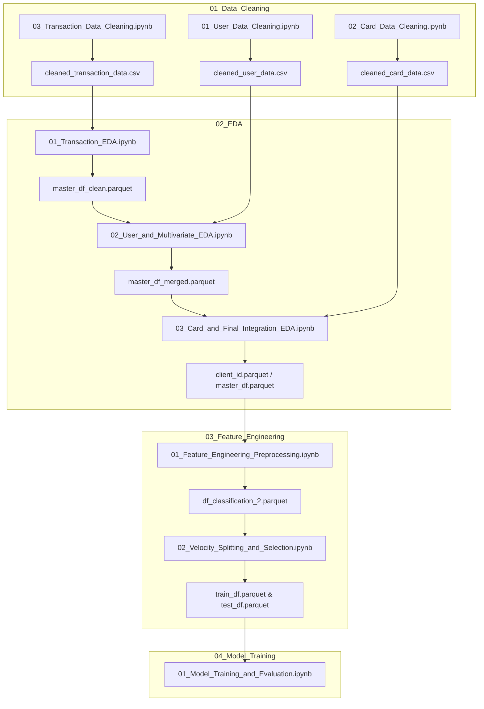

# FinGuard: Online Transaction Fraud Detection System

AI-powered Transaction Risk Intelligence Platform that integrates transaction, customer, card, and merchant data to detect fraud, identify anomalous transactions, and segment customers based on behavior. Features machine learning, clustering, anomaly detection, and interactive dashboards for risk analytics.

An end-to-end Machine Learning pipeline for large-scale financial fraud detection and classification. This repository contains the complete workflow—from ingesting and cleaning 13.3+ million transactions across multi-table relational databases, in-depth exploratory data analysis, leakage-free temporal feature engineering, multi-algorithm feature selection, and data drift diagnostics, to advanced gradient boosted decision trees (XGBoost), Bayesian hyperparameter optimization, and Precision-Recall decision threshold calibration.

---

## Table of Contents
1. [Architecture](#architecture)
2. [Project Overview](#project-overview)
3. [Pipeline Architecture and Execution Flow](#pipeline-architecture-and-execution-flow)
4. [Repository Structure and Notebook Modules](#repository-structure-and-notebook-modules)
   - [01 Data Cleaning](#01-data-cleaning)
   - [02 Exploratory Data Analysis](#02-exploratory-data-analysis)
   - [03 Feature Engineering and Selection](#03-feature-engineering-and-selection)
   - [04 Model Training and Evaluation](#04-model-training-and-evaluation)
5. [Comprehensive Model Evaluation and Metrics](#comprehensive-model-evaluation-and-metrics)
6. [Data Drift and Stability Analysis (PSI)](#data-drift-and-stability-analysis-psi)
7. [Setup and Reproducibility Guide](#setup-and-reproducibility-guide)

---

## Project Overview

Financial transaction fraud detection presents severe real-world challenges:
- **Massive Data Scale**: Over 13.3 million transaction records linked to cardholder demographics and card issuance profiles.
- **Extreme Class Imbalance**: Fraud prevalence is merely **~0.14% in the training split** and **~0.17% in the testing split** (~3,130 fraud cases out of ~1.8 million test transactions).
- **Temporal Dynamics and Concept Drift**: Industry-wide card technology shifts (e.g., nationwide EMV chip migration in 2015) and evolving fraud attack vectors across a 10-year timeline.
- **Evaluation Deception**: Standard evaluation metrics like Accuracy (>99.8%) and ROC-AUC (~0.9909) yield a dangerously false sense of model efficacy. The real-world business objectives are **PR-AUC (Precision-Recall Area Under Curve)**, **Recall** (capturing financial crime), and calibrated **Precision** (minimizing customer friction and operational review overhead).

---

## Pipeline Architecture and Execution Flow

The project is structured into four sequential, modular stages:



---

## Repository Structure and Notebook Modules

### 01 Data Cleaning

#### 1. [01_User_Data_Cleaning.ipynb](01_Data_Cleaning/01_User_Data_Cleaning.ipynb)
- **Input**: Raw `users_data.csv` (2,000 unique cardholders, 14 attributes).
- **Operations**:
  - Validates demographic profiles: `current_age` (mean 45.4, range 18–101), `retirement_age` (mean 66.2), `birth_year`, and geographic coordinates.
  - Sanitizes string currency symbols into numeric values for financial features: `per_capita_income`, `yearly_income`, `total_debt`, and `credit_score`.
  - **Output**: `cleaned_user_data.csv`.

#### 2. [02_Card_Data_Cleaning.ipynb](01_Data_Cleaning/02_Card_Data_Cleaning.ipynb)
- **Input**: Raw `cards_data.csv` (6,146 cards across cardholders).
- **Operations**:
  - Profiles card distribution: Brands (Mastercard: 3,209, Visa: 2,326, Amex: 402, Discover: 209), Card Types (Debit: 3,511, Credit: 2,057, Prepaid: 578), Chip Status (True: 5,500, False: 646).
  - Sanitizes currency formatting for `credit_limit`.
  - Identifies and drops zero-variance attribute `card_on_dark_web` (100% "No").
  - **Output**: `cleaned_card_data.csv`.

#### 3. [03_Transaction_Data_Cleaning.ipynb](01_Data_Cleaning/03_Transaction_Data_Cleaning.ipynb)
- **Input**: Raw `transactions_data.csv` (13,305,915 transaction records, 12 attributes).
- **Operations**:
  - Parses timestamps and formats ISO datetimes.
  - Cleans string monetary amounts (`$`) and processes refund records (negative values down to -$500.00; mean amount $42.98).
  - Encodes transaction channels: `Swipe Transaction` (6.97M), `Chip Transaction` (4.78M), and `Online Transaction` (1.56M).
  - Categorizes 211,393 authorization error codes across technical glitches, bad PIN, bad CVV, and insufficient balance.
  - **Output**: `cleaned_transaction_data.csv`.

---

### 02 Exploratory Data Analysis

#### 4. [01_Transaction_EDA.ipynb](02_EDA/01_Transaction_EDA.ipynb)
- **Focus**: Transaction-Level Univariate and Bivariate Exploration and Ground-Truth Merging.
- **Key Findings**:
  - **EMV Migration**: Uncovers the historical 2015 payment transition where Chip transactions rapidly replaced Swipe transactions.
  - **Transaction Value**: Fraudulent transactions average **~2.5x higher monetary value** than legitimate transactions, with severe fraud concentration in the $2,000–$5,000 bracket (12.27% fraud rate).
  - **Channel Vulnerability**: Online transactions exhibit a **0.84% fraud rate** (>8x higher than Chip at 0.10%).
  - **Geographic Hotspots**: Rome / Italy stands out with 3,061 fraud events and a **37.83% – 43.23% fraud rate**.
  - **High-Risk MCCs**: Electronics Stores (MCC 5732) at 5.75% fraud rate; Precious Stones and Metals (MCC 5094) at 4.67%.
  - **Output**: `master_df_clean.parquet`.

#### 5. [02_User_and_Multivariate_EDA.ipynb](02_EDA/02_User_and_Multivariate_EDA.ipynb)
- **Focus**: Multivariate Interaction Exploration and User Demographic Merging.
- **Key Findings**:
  - Joins cardholder demographic tables (`master_df.merge(user_df)`).
  - **Error Signal**: `Bad CVV` is the single strongest error-related fraud indicator (fraud rate **3.40%**, vs ~0.15% population baseline).
  - **Demographics**: Credit scores show zero divergence between fraud and non-fraud transactions (mean ~714 for both). However, fraud rate increases steadily with cardholder age (0.13% in 20–40 age bracket up to 0.18% in 60–80).
  - **Card Portfolio Exposure**: Fraud probability scales directly with the number of credit cards owned (from 0.10% for 1 card up to 0.37% for 8–9 cards).
  - **Output**: `master_df_merged.parquet`.

#### 6. [03_Card_and_Final_Integration_EDA.ipynb](02_EDA/03_Card_and_Final_Integration_EDA.ipynb)
- **Focus**: Card Portfolio Integration and Multi-table Risk Profiling.
- **Key Findings**:
  - Joins card issuance attributes (`master_df.merge(card_df)`).
  - Evaluates predictive signals across card parameters: Strong (`card_type`, `credit_limit`, `num_cards_issued`), Moderate (`card_brand`), Weak/Irrelevant (`cvv`, raw `card_number`).
  - **Output**: `client_id.parquet` and `master_df.parquet`.

---

### 03 Feature Engineering and Selection

#### 7. [01_Feature_Engineering_Preprocessing.ipynb](03_Feature_Engineering/01_Feature_Engineering_Preprocessing.ipynb)
- **Focus**: Target Hygiene, Identifier Pruning, and Base Aggregations.
- **Operations**:
  - Cleans missing ground-truth target entries.
  - Drops redundant high-cardinality and location coordinates (`zip`, `retirement_age`, `latitude`, `longitude`, `acct_open_date`, `year_pin_last_changed`).
  - Derives financial ratios (`debt_to_income`) and refund flags.
  - Builds initial client-level monetary aggregates on absolute transaction values (`abs_amount`).
  - **Output**: `df_classification_2.parquet` (8.99M rows).

#### 8. [02_Velocity_Splitting_and_Selection.ipynb](03_Feature_Engineering/02_Velocity_Splitting_and_Selection.ipynb)
- **Focus**: Rolling Velocity, Strict Chronological Splitting, and Multi-Algorithm Feature Selection.
- **Operations**:
  - **High-Speed Polars Windowing**: Computes rolling 24-hour transaction frequency (`txn_count_last_24h`) and monetary volume (`amount_sum_last_24h`).
  - **Strict Leakage Prevention and Temporal Train-Test Split**:
    - Eradicates look-ahead bias by splitting chronologically by `transaction_datetime`:
      - **Train Split (80%)**: 7,194,581 records (`2010-01-01 00:01:00` to `2017-12-04 11:31:00`, fraud rate: 0.144%).
      - **Test Split (20%)**: 1,798,646 records (`2017-12-04 11:32:00` to `2019-10-31 23:57:00`, fraud rate: 0.174%).
    - Computes all historical group statistics (MCC, City, State, Customer) strictly on the Train split and maps them forward to the holdout Test split.
  - **Multicollinearity Pruning (VIF and Correlation Analysis)**:
    - Samples 500,000 rows to calculate Variance Inflation Factors:
    - Drops `state_avg_amount` (VIF 55.7), `mcc` (VIF 40.5), `state_unique_customers` (VIF 30.6), `customer_std_amount` (VIF 28.0), `amount_vs_avg` (corr 0.965 with z-score), `per_capita_income` (corr 0.949 with yearly income), `city_txn_count` (corr 0.929 with unique customers).
  - **Multi-Method Feature Importance Ensemble**:
    - Evaluates feature sets using consensus ranking across:
      1. Random Forest Feature Importance (Gini importance)
      2. XGBoost Feature Importance (Weight / Gain)
      3. Permutation Feature Importance (Holdout performance drop)
  - **Output**: `train_df.parquet` and `test_df.parquet`.

---

### 04 Model Training and Evaluation

#### 9. [01_Model_Training_and_Evaluation.ipynb](04_Model_Training/01_Model_Training_and_Evaluation.ipynb)
- **Focus**: Imbalanced Classification, Metric Selection, Hyperparameter Search, Drift Diagnostics, and Decision Threshold Calibration.
- **Operations and Results**:
  - Preprocessing pipeline built with `ColumnTransformer` (`StandardScaler` on numerical columns, `OneHotEncoder(handle_unknown='ignore')` on categorical columns).
  - Handles extreme class imbalance using `scale_pos_weight` and balanced class weights.
  - **ROC-AUC Deception Analysis**: Demonstrates that ROC-AUC yields an artificially elevated score of **0.9909** due to true negative dominance, establishing **PR-AUC** as the definitive target metric.
  - **Hyperparameter Optimization (`RandomizedSearchCV`)**: 3-fold cross-validation exploring regularized tree structures, achieving a holdout Test PR-AUC of **0.3810**.
  - **Population Stability Index (PSI) Drift Verification**: Evaluates distribution shifts across numerical and categorical features between Train (2010–2017) and Test (2017–2019), confirming zero covariate drift (`errors` PSI: 0.0000, `card_brand` PSI: 0.0001; all numerical PSI << 0.1).
  - **Optuna Bayesian Optimization**: 25-trial optimization study on cross-validated average precision.
  - **Precision-Recall Decision Threshold Calibration**: Calibrates the classification threshold from the default 0.50 to **0.8539**, lifting precision from 13.0% to **37.33%** while retaining **44.12% recall** for an overall F1-score of **0.4045**.

---

## Comprehensive Model Evaluation and Metrics

The table below summarizes performance across model configurations evaluated on the holdout test set (1,798,646 transactions; 3,130 positive fraud cases):

| Model Pipeline | Configuration / Hyperparameters | Decision Threshold | Precision | Recall | F1-Score | Holdout PR-AUC | Train PR-AUC | Generalization Gap | ROC-AUC |
| :--- | :--- | :---: | :---: | :---: | :---: | :---: | :---: | :---: | :---: |
| Baseline Random Forest | `n_est=50, depth=8, class_weight='balanced'` | 0.50 | 0.0200 | **1.0000** | 0.0330 | 0.2455 | — | — | — |
| Baseline XGBoost | `scale_pos_weight, depth=8, lr=0.1` | 0.50 | 0.0700 | 0.7700 | 0.1280 | 0.1844 | — | — | 0.9909 |
| High-Recall XGBoost | `scale_pos_weight=200, depth=5, lr=0.05` | 0.50 | 0.0600 | 0.9200 | 0.1210 | 0.1698 | — | — | — |
| Deep XGBoost Variant | `depth=7, n_est=300, lr=0.05` | 0.50 | **0.8500** | 0.2000 | 0.3180 | 0.4955 | 0.9833 | 0.4878 | — |
| RandomizedSearch XGBoost | `depth=5, lr=0.1, spw=100, reg=5` | 0.50 | 0.1300 | 0.8200 | 0.2300 | **0.3810** | 0.7735 | 0.3925 | — |
| **RandomizedSearch XGBoost (Calibrated)** | **depth=5, lr=0.1, spw=100, reg=5** | **0.8539** | **0.3733** | **0.4412** | **0.4045** | **0.3810** | 0.7735 | 0.3925 | — |
| Optuna Tuned XGBoost | `depth=6, n_est=271, spw=139` | 0.50 | 0.1900 | 0.5900 | 0.2900 | 0.3177 | 0.9087 | 0.5910 | — |
| Optuna Tuned XGBoost (Calibrated) | `depth=6, n_est=271, spw=139` | 0.7708 | 0.3314 | 0.3949 | 0.3603 | 0.3177 | 0.9087 | 0.5910 | — |
| Conservative Regularized XGBoost | `depth=4, gamma=3, mcw=30, spw=100` | 0.50 | 0.0800 | 0.9200 | 0.1500 | 0.2721 | 0.5067 | 0.2346 | — |

> **Why PR-AUC Over ROC-AUC?**  
> Under extreme class imbalance (~0.17%), ROC-AUC generates an artificially inflated score of **0.9909** because the immense volume of true negatives overwhelms the false positive rate. PR-AUC evaluates precision against recall directly, accurately reflecting the real-world trade-off between fraud capture and false alerts.

---

## Data Drift and Stability Analysis (PSI)

To verify that models trained on historical transactions (2010–2017) remain reliable on subsequent periods (2017–2019), **Population Stability Index (PSI)** was evaluated across all feature distributions:

$$\text{PSI} = \sum \left( \% \text{ Actual} - \% \text{ Expected} \right) \times \ln\left( \frac{\% \text{ Actual}}{\% \text{ Expected}} \right)$$

- **PSI Standards**:
  - $\text{PSI} < 0.1$: Stable distribution; no drift.
  - $0.1 \le \text{PSI} < 0.25$: Moderate drift; monitoring required.
  - $\text{PSI} \ge 0.25$: Significant shift; retraining recommended.

**Evaluated PSI Results**:
- **Numerical Features**: Binned across 10 deciles. Every numerical feature registered $\text{PSI} \ll 0.1$ (zero features exceeded 0.05).
- **Categorical Features**:
  - `errors`: $\text{PSI} = 0.0000$
  - `card_brand`: $\text{PSI} = 0.0001$
  - `card_type`: $\text{PSI} = 0.0001$

**Conclusion**: The generalization gap between train and test splits is driven by model regularization and extreme class sparsity rather than covariate feature drift.

---

## Setup and Reproducibility Guide

### 1. Environment Requirements
- Python 3.9+
- Hardware: 16GB+ RAM (or Kaggle/cloud environment with high memory).

### 2. Dependencies
```bash
pip install numpy pandas polars scikit-learn xgboost optuna matplotlib seaborn pyarrow fastparquet
```

### 3. Execution Sequence
To run the entire pipeline in order:
1. **01 Data Cleaning**:
   - Run `01_Data_Cleaning/01_User_Data_Cleaning.ipynb`
   - Run `01_Data_Cleaning/02_Card_Data_Cleaning.ipynb`
   - Run `01_Data_Cleaning/03_Transaction_Data_Cleaning.ipynb`
2. **02 Exploratory Data Analysis**:
   - Run `02_EDA/01_Transaction_EDA.ipynb`
   - Run `02_EDA/02_User_and_Multivariate_EDA.ipynb`
   - Run `02_EDA/03_Card_and_Final_Integration_EDA.ipynb`
3. **03 Feature Engineering**:
   - Run `03_Feature_Engineering/01_Feature_Engineering_Preprocessing.ipynb`
   - Run `03_Feature_Engineering/02_Velocity_Splitting_and_Selection.ipynb`
4. **04 Model Training and Evaluation**:
   - Run `04_Model_Training/01_Model_Training_and_Evaluation.ipynb`
